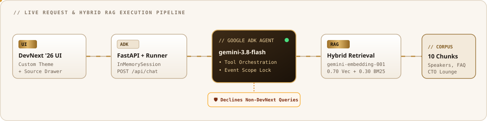
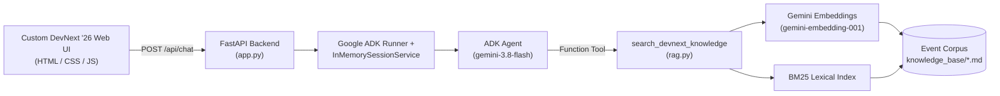

<div align="center">

<!-- Animated Architectural Hero Banner (Embedded Official ET DEVNEXT'26 Lockup + SVG Motion) -->
<a href="https://devnext-adk-145989035319.asia-south1.run.app">
  
</a>

<br />

<!-- Primary Action CTA Badges -->
[-CFA55A?style=for-the-badge&logo=googlecloud&logoColor=1E1915&labelColor=1E1915)](https://devnext-adk-145989035319.asia-south1.run.app)
[](https://techgig.com/devnext)
[](https://www.linkedin.com/in/abhakare/)

<!-- Technology Stack Logo Badges -->


<p align="center">
  <strong>An event-scoped AI Concierge built with the Google Agent Development Kit (<code>google-adk</code>) and Hybrid Gemini RAG — wrapped in a bespoke <em>ET TechGig DevNext ’26</em> interface instead of the default <code>adk web</code> UI.</strong>
</p>

</div>


## `// LIVE CONVERSATION & GUARDRAIL PREVIEW`

<div align="center">
  
</div>

<br />

| Capability | What Makes This Implementation Different |
| :--- | :--- |
| 🎨 **Authentic DevNext ’26 UI** | Replaces default `adk web` developer chrome with the live event's **warm ivory (`#FAF6F0`), espresso-bronze, chamfered stat cards, metallic gold CTAs, and floating pill navbar**. |
| 🧠 **Google ADK Stateful Engine** | Uses `Agent`, `Runner`, and `InMemorySessionService` with **`gemini-3.8-flash`** for multi-turn conversational context over clean FastAPI endpoints. |
| ⚡ **Hybrid Vector + BM25 RAG** | Fuses **`gemini-embedding-001`** dense cosine similarity (`0.70`) + **BM25** lexical ranking (`0.30`) with `.rag_cache.json` disk caching and inline **Grounded Source Citations**. |
| 🛡️ **Strict Event-Only Guardrail** | Hard-locked to **ET TechGig DevNext ’26** (Hyderabad • Nov 21, 2026); politely declines general coding, math, trivia, or off-topic prompts. |
| ☁️ **Zero-Cold-Wait Cloud Run** | Containerized and deployed on **Google Cloud Run (`asia-south1`)** with precomputed vector cache for instant startup. |


## `// ANIMATED SYSTEM ARCHITECTURE`

<div align="center">
  
</div>

<details>
<summary><strong>📐 View Mermaid Architecture Source</strong></summary>



</details>


## `// REPOSITORY STRUCTURE`

```text
devnext-adk/
├── app.py                        # FastAPI server wiring ADK Runner, Sessions & custom UI routes
├── devnext_agent/
│   ├── __init__.py               # Package exports (root_agent, build_agent)
│   ├── agent.py                  # Google ADK Agent (gemini-3.8-flash) + strict event-only instructions
│   └── rag.py                    # Hybrid RAG engine (gemini-embedding-001 + BM25 + citation tracking)
├── knowledge_base/
│   └── devnext_2026_kb.md        # 10 structured event sections from techgig.com/devnext
├── templates/
│   └── index.html                # Custom ET TechGig DevNext '26 UI layout
├── static/
│   ├── styles.css                # Warm bronze/gold/ivory DevNext '26 design system
│   └── app.js                    # Session chat, Markdown renderer & RAG source citations drawer
├── assets/                       # Animated SVG hero, RAG pipeline & chat showcase graphics
├── image.png                     # Official ET TechGig DevNext '26 hero logo lockup
├── Dockerfile                    # Production container image for Google Cloud Run
└── requirements.txt              # Python dependencies
```


## `// QUICK START (LOCAL & CLOUD RUN)`

### 1. Clone & Install Dependencies

```powershell
git clone https://github.com/bhakareashutosh/devnext-adk.git
cd devnext-adk

python -m venv .venv
.\.venv\Scripts\pip install -r requirements.txt   # Linux/macOS: ./.venv/bin/pip install -r requirements.txt
```

### 2. Configure Your Gemini API Key

Copy `.env.example` to `.env` and set your [Google AI Studio API Key](https://aistudio.google.com/apikey) *(or click **Configure Key** directly in the web UI navbar)*:

```env
GOOGLE_API_KEY=your_gemini_api_key_here
GEMINI_MODEL=gemini-3.8-flash
EMBEDDING_MODEL=gemini-embedding-001
```

### 3. Run Locally

```powershell
.\.venv\Scripts\python.exe app.py
```

Open **`http://127.0.0.1:8080`** in your browser. Drop any extra `.md` or `.txt` files into `knowledge_base/` to automatically index additional event content.

### 4. One-Command Deploy to Google Cloud Run

```bash
gcloud run deploy devnext-adk \
  --source . \
  --project=YOUR_GCP_PROJECT_ID \
  --region=asia-south1 \
  --allow-unauthenticated \
  --port=8080 \
  --memory=1Gi \
  --set-env-vars="GOOGLE_API_KEY=YOUR_API_KEY,GEMINI_MODEL=gemini-3.8-flash,EMBEDDING_MODEL=gemini-embedding-001"
```


## `// AUTHOR & SPEAKER SPOTLIGHT`

<div align="center">

### **Ashutosh S. Bhakare**
**Featured Speaker — ET TechGig DevNext ’26 (Hyderabad)**  
*Founder & CEO at **[BYOLabs.in](https://byolabs.in)** • Director & Chief Corporate Trainer at **[Unnati Development & Training Centre Pvt. Ltd.](https://unnatidevelopment.in)***

<br />

<!-- Credentials & Ecosystem Badges with Official Logos -->


<p align="center">
  25+ years of international consulting, architecture, and corporate training experience across <strong>Cloud Computing, Agentic AI Systems, Kubernetes, DevOps, and Enterprise Linux</strong> across India, Australia, Singapore, Indonesia, and Hong Kong.
</p>

[](https://www.linkedin.com/in/abhakare/)
[](https://github.com/bhakareashutosh)
[](https://byolabs.in)

</div>
