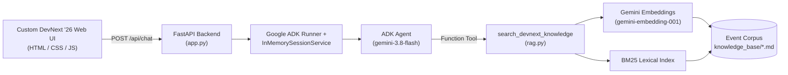

# ET TechGig DevNext ’26 — Custom Google ADK + Hybrid RAG Concierge

> **Live Demo (Google Cloud Run):** [https://devnext-adk-145989035319.asia-south1.run.app](https://devnext-adk-145989035319.asia-south1.run.app)  
> **Event Page:** [https://techgig.com/devnext](https://techgig.com/devnext) • **November 21, 2026 | Hyderabad**

A production-ready reference application built with the **Google Agent Development Kit (`google-adk`)**, **Gemini 3.8 Flash (`gemini-3.8-flash`)**, and **Hybrid Gemini RAG (`gemini-embedding-001` + BM25)**—served through a **custom FastAPI web interface** styled directly after the **ET TechGig DevNext ’26** conference theme rather than the default `adk web` developer UI.

---

## Key Highlights

* **Custom Branded UI (No `adk web` Chrome):** Bespoke HTML/CSS/JS frontend matching `techgig.com/devnext`—warm ivory & sand surfaces (`#FAF6F0`), architectural espresso-bronze hero with the `ET DEVNEXT'26` lockup, chamfered stat cards, `Space Grotesk` + `// SECTION` developer typography, metallic gold CTAs, and expandable RAG source citations.
* **Google ADK Stateful Runtime:** Powered by `google.adk.agents.Agent`, `Runner`, and `InMemorySessionService` for multi-turn conversational sessions over REST (`/api/chat`).
* **Hybrid Vector + Lexical RAG:** Combines dense **Gemini Embeddings (`gemini-embedding-001`)** cosine similarity (cached on disk in `.rag_cache.json` for zero-latency cold starts) with **BM25** lexical scoring across all DevNext ’26 knowledge chunks.
* **Strict Event-Only Guardrail:** Enforces an event-scoped instruction lock so the concierge answers questions **exclusively** about **ET TechGig DevNext ’26** (speakers, tracks, The CTO Lounge, eligibility, timings, ticket refund policy, and contacts) and politely declines unrelated coding or general queries.
* **Serverless Cloud Run Deployment:** Containerized with `Dockerfile` and deployed on **Google Cloud Run** (`asia-south1`).

---

## Architecture



---

## Project Structure

```text
devnext-adk/
├── app.py                        # FastAPI server wiring ADK Runner, Sessions & custom UI routes
├── devnext_agent/
│   ├── __init__.py               # Exports root_agent and build_agent
│   ├── agent.py                  # Google ADK Agent (gemini-3.8-flash) + strict event-only instructions
│   └── rag.py                    # Hybrid RAG engine (gemini-embedding-001 + BM25 + citation tracking)
├── knowledge_base/
│   └── devnext_2026_kb.md        # Structured knowledge base extracted from techgig.com/devnext
├── templates/
│   └── index.html                # Custom ET TechGig DevNext '26 UI layout
├── static/
│   ├── styles.css                # Warm bronze/gold/ivory DevNext '26 design system
│   └── app.js                    # Session chat, Markdown renderer & RAG source citations drawer
├── image.png                     # Official ET TechGig DevNext '26 hero logo lockup
├── Dockerfile                    # Production container image for Google Cloud Run
├── .gcloudignore                 # Excludes local .venv and .env from Cloud Build uploads
├── .env.example                  # Environment variable template
└── requirements.txt              # Python dependencies
```

---

## Local Quick Start

### 1. Create a Virtual Environment & Install Dependencies

**Windows (PowerShell):**
```powershell
python -m venv .venv
.\.venv\Scripts\pip install -r requirements.txt
```

**Linux / macOS:**
```bash
python3 -m venv .venv
./.venv/bin/pip install -r requirements.txt
```

### 2. Configure Your Gemini API Key

Copy `.env.example` to `.env` and add your key from [Google AI Studio](https://aistudio.google.com/apikey) *(or set it interactively via the **Configure Key** button in the top navbar)*:

```env
GOOGLE_API_KEY=your_gemini_api_key_here
GEMINI_MODEL=gemini-3.8-flash
EMBEDDING_MODEL=gemini-embedding-001
```

### 3. Run the Application

```powershell
.\.venv\Scripts\python.exe app.py
```

Open **`http://127.0.0.1:8080`** in your browser.  
*(Tip: Drop any additional `.md` or `.txt` files into `knowledge_base/` to automatically expand the RAG index.)*

---

## Deploying to Google Cloud Run

Deploy directly from source using the Google Cloud CLI:

```bash
gcloud run deploy devnext-adk \
  --source . \
  --project=YOUR_GCP_PROJECT_ID \
  --region=asia-south1 \
  --allow-unauthenticated \
  --port=8080 \
  --memory=1Gi \
  --set-env-vars="GOOGLE_API_KEY=YOUR_API_KEY,GEMINI_MODEL=gemini-3.8-flash,EMBEDDING_MODEL=gemini-embedding-001"
```

---

## Author & Speaker

**Ashutosh S. Bhakare**  
*Featured Speaker at **ET TechGig DevNext ’26** (Hyderabad)*

* **Founder & CEO** — [BYOLabs.in](https://byolabs.in)
* **Director & Chief Corporate Trainer** — [Unnati Development and Training Centre Pvt. Ltd.](https://unnatidevelopment.in)
* **Credentials & Community:** 25+ years of international consulting & corporate training experience across Cloud Computing, AI/Agentic Systems, Kubernetes, DevOps, and Enterprise Linux • **Google Authorized Trainer** • **Docker Captain** • **Red Hat Certified Architect & Instructor (RHCA / RHCI)** • **CNCF Certified (CKA, CKAD, CKS)** • **Open-Source Advocate**
* **Connect:**
  * **LinkedIn:** [https://www.linkedin.com/in/abhakare/](https://www.linkedin.com/in/abhakare/)
  * **GitHub:** [https://github.com/bhakareashutosh](https://github.com/bhakareashutosh)
